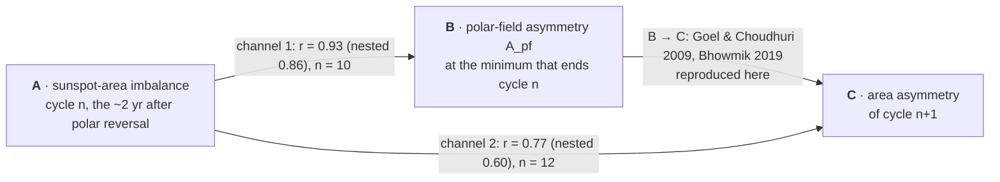
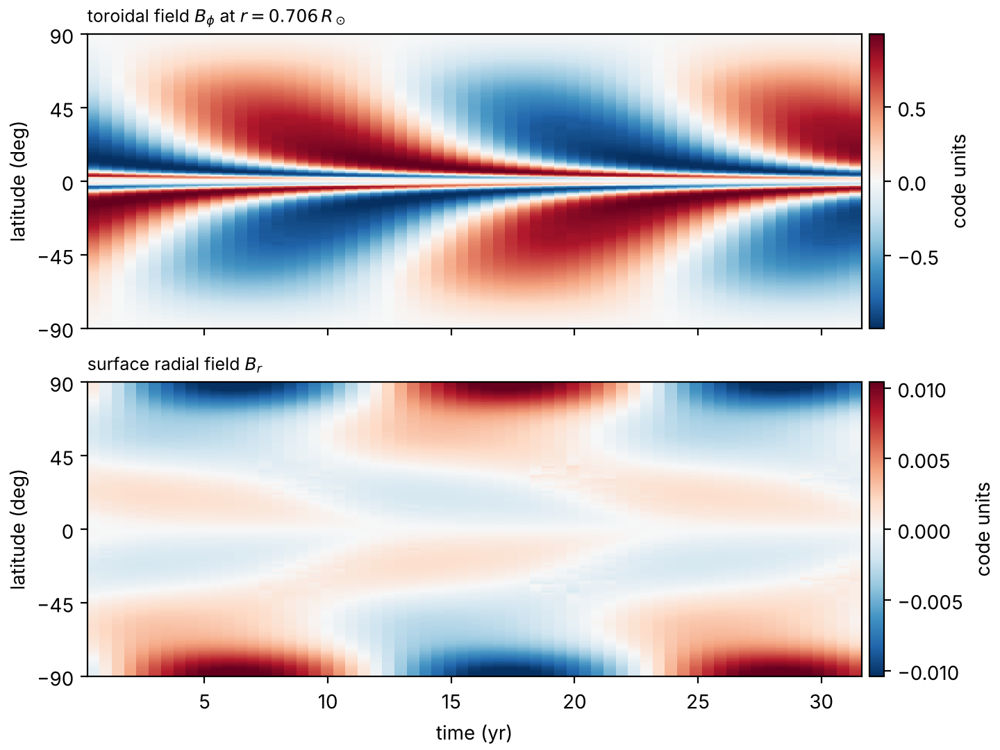

# Hemispheric asymmetry of the Sun

The two hemispheres of the Sun never produce the same amount of activity. Each solar minimum also ends with one polar field stronger than the other. This project asks how the first sets the second, and whether both carry over into the next cycle. It uses 150 years of sunspot regions (RGO + SOON), a century of polar-field measurements (Mount Wilson faculae, then WSO) and a surface-flux-transport model that is read out exactly the way the data are.

The manuscript is in revision. This repository holds the pipeline that reproduces every number and figure in it, the core library for new work, and the extension that goes after the mechanism: why the channels work, why one hemisphere stays dominant for several cycles, and how far SFT and dynamo models (including SURYA) reproduce it.

---

## The short version



- **Channel 1 (A → B).** The latitude-weighted N − S sunspot-area imbalance in the year of the polar reversal and the year after it, multiplied by the parity factor (−1)^(n+1), predicts the polar-field asymmetry at the next minimum: r = 0.927 over cycles 15–24, with the right sign in 10 of 10 cycles. Under nested leave-one-cycle-out selection of the window the value is 0.857.
- **Channel 2 (A → C).** The unsigned imbalance over a wider window (the six whole years from t_R − 1 to t_R + 5) predicts the next cycle's whole-cycle area asymmetry: r = 0.771 over the pairs 12→13 … 23→24, 10 of 12 signs, 0.599 nested. Much of this is persistence (the dominant hemisphere tends to stay dominant; lag-1 r of the imbalance is +0.57), so channel 2 is best read as a persistence link, not as independent new information.
- **Out of sample.** Fitted on cycles 15–24, the model predicts Cycle 14 (MWO polar data) with a 95% interval of [−0.119, +0.075]. The observation, −0.147 ± 0.143, passes the pre-registered rule (its ±1σ range overlaps the interval), but the point value lies outside it.
- **Prospective test.** A prediction for the Cycle 25 polar asymmetry was registered and hash-stamped before the data exist (`rev.n7`).

The nested numbers are the honest ones. The in-sample r values are maxima of a window scan, and the gap between the two (0.93 → 0.86, 0.77 → 0.60) is the price of that search.

## Definitions

| Symbol | Definition |
|---|---|
| A_pf(n) | (\|B_N\| − \|B_S\|) / (\|B_N\| + \|B_S\|), polar field averaged ±1.6 yr about the minimum that **ends** cycle n. Mount Wilson polar faculae up to SC19, WSO daily filtered field from SC20. |
| t_R | polar-reversal epoch of cycle n |
| X1(n; s, e) | Σ over whole years y with y + 0.5 in [t_R + s, t_R + e + 1) of (A_N − A_S)_y / ⟨\|lat\|⟩_y, where A_N, A_S are hemispheric sunspot areas in MSH |
| X̂1 | (−1)^(n+1) · X1, the parity-signed form, used only against polar-field targets |
| A^n | whole-cycle (minimum to minimum) area asymmetry (N − S)/(N + S) |
| size class | set by each region's **peak** area, which needs the unique region ids of the corrected catalogue |

Rows at latitude 0 are dropped. The parity factor is an empirical regularity: it equals −sgn B_N at every minimum in the record. It is **not** presented as a Hale-law correction.

## How the results were checked

With 10–12 cycles, a correlation found by searching is easy to get and hard to trust. Everything here was built around that problem.

- **Nested leave-one-cycle-out.** The window is re-chosen inside each fold without the held-out cycle, so the held-out prediction never sees its own data.
- **Family-wise permutation p** for every scanned maximum (the null is the *maximum* r over the same search, not a single r).
- **Specification curve** over ~2 million predictor definitions, with a max-statistic null (`rev.t1`).
- **Errors in variables.** A_pf uncertainties from the published SEMs are propagated, and the best r attainable under them is computed (`rev.t3`).
- **Rivals.** Channel 2 is tested against plain persistence, surrogates and rolling-origin forecasts (`rev.t4`); size effects against matched nulls (`rev.t5`); RGO → SOON and MWO → WSO splices under nine calibrations (`rev.t6`).
- **Multiplicity.** BH and Holm corrections across every test in the paper (`rev.t8`).
- **Replication** on the SILSO hemispheric sunspot numbers, an independent catalogue (`rev.n6`).
- **Reproducibility.** One command reruns any step and checks it numerically against the stored result (see below).

This list says what was tested, not how each test came out. The outcomes are in the manuscript and in the `out/*.json` file of each step.

## How this relates to earlier work

Most of the literature tests **B → C**: the polar asymmetry at minimum seeds the next cycle's asymmetry (Goel & Choudhuri 2009; Nagy et al. 2017; Bhowmik 2019). Dynamo and SFT studies explain *where* asymmetry comes from: random kicks to a weakly damped quadrupole mode (Schüssler & Cameron 2018), tilt scatter (Karak & Miesch 2017; Bhowmik 2019), single "rogue" regions (Nagy et al. 2017) or asymmetric meridional flow (Belucz & Dikpati 2013). Svalgaard & Kamide (2013) showed that the more active hemisphere reverses first.

What this project adds:

- **A → B as a measured, cycle-by-cycle relation**, not just a timing argument or a model result.
- **A direct A → C channel**, tested against persistence (most of it is persistence), and then **the persistence and flips of the dominant hemisphere** studied directly, in data and in models.
- **Per-region size classes** on a catalogue with unique region ids.
- **An SFT model read out like the data** (same windows, same caps).
- **The two sign changes (SC14, SC21)**, treated as tests.
- **A head-to-head comparison with Bhowmik (2019)**: her results recomputed on her definitions, and ours rerun in her SFT and her SURYA dynamo.
- **A statistics protocol built for n ≈ 10**, including a registered prediction.

The full map, with what each paper means for this one, is in [`docs/literature.md`](docs/literature.md).

## Beyond the paper: the extension

[`extension/`](extension/) holds the second stage, written up as reports v4–v8. The main findings so far:

- **Large regions carry channel 1.** r = 0.97 for regions ≥ 1000 MSH, 0.58 for regions < 100 MSH (scan-chosen windows).
- **A candidate origin for the parity factor.** Even cycles switch their dominant hemisphere after maximum (5 of 7), odd cycles never do (0 of 6). With declining-phase emergence the A_pf sign comes out right in 9 of 10 cycles without any parity factor. Exploratory: the result is window-sensitive.
- **Persistence and flips.** The area imbalance has a cycle-to-cycle memory (lag-1 r = +0.57, n = 12). Both sign changes (SC14, SC21) go through a near-balanced cycle whose sign a region bootstrap cannot fix.
- **Models.** Both the project's SFT and Bhowmik's reproduce A_pf in odd cycles (r = 0.95–0.97) but not in even ones (≈ 0.01). A 1-D SFT has no inter-cycle memory. The project's own 2-D dynamo needs ~30-yr coherent source fluctuations to match the Sun's persistence. Bhowmik's dynamo on SURYA (Passos et al. 2014 noise plus pumping) gets most of it at standard noise (lag-1 r = +0.45), though its same-sign runs are still shorter than the Sun's.
- **Against Bhowmik (2019).** Her polar → next-cycle link reproduces in sign, not in size (+0.59 against her 0.73 on her own pairs). The two SFTs disagree on what drives the polar asymmetry: tilt scatter gives 3.7 % here against her 36 %, while flow differences matter far more here than in her model.

Details, with the Sun/model label on every claim, are in [`extension/README.md`](extension/README.md). The last SURYA batch (v8) was stopped before it finished, so its dynamo results are partial.

## Limitations

- **Small samples.** Channel 1 rests on 10 cycles, channel 2 on 12. One unusual cycle can move r by a lot; the drop-one and Spearman controls (`p4.controls`) are there for this reason.
- **The parity factor is not yet explained.** Channel 1 only works after multiplying by (−1)^(n+1). The even-cycle switch (see the extension) is a candidate explanation, but it is exploratory.
- **The window is empirical.** The channel-1 window is the top of a broad plateau in a scan. The window the SFT says should build the polar imbalance (t_R + 2.3 to + 5.1 yr) ranks only 74th and 51st of 104 in the two channels' scans.
- **Models fail in even cycles.** Every SFT run reproduces A_pf in odd cycles only, which limits every model statement.
- **Two instruments.** A_pf switches from calibrated faculae counts to WSO magnetograms at SC20. The splice is tested, but it is a seam in the middle of a 10-point series.
- **Cycle 14 is a weak pass.** It passes on the pre-registered ±1σ rule, but the point value is outside the 95% prediction interval.
- **Incomplete code.** The analysis scripts under `paper/`, the extension's shared modules (`core.py`, `q4_dynamo*.py`, …) and the two extended SURYA copies are not in this repository yet. Until they are, the repository documents the work but cannot rerun it.

## Repository layout

```
pipeline/
    master.py        registry of every analysis and figure step (~100 scripts, 4 stages) and the runner
    asymcore.py      reusable core: data, predictor, polar field, statistics, SFT, plotting
    README.md        every step, its inputs, outputs, cost, and which script makes each figure
dynamo/
    surya_2.f        modified Surya flux-transport dynamo (Choudhuri group, IISc)
    init.dat         relaxed dipolar starting state, 257 x 257 grid
    run.sh, Makefile, plot_run.py
extension/
    *.py             closure tests, the Bhowmik (2019) comparison, the SURYA ensembles (v4-v8)
    reports/         the generated reports v4, v5, v7, v8
docs/
    literature.md    earlier work and where this project sits
```

`master.py` and `asymcore.py` drive the analysis scripts under `paper/` (the stage folders `corrected_reanalysis/`, `revision/`, `revision/p4/` and the modules `lib_asym`, `common`, `p4lib`, `x_engine`, `bn_sft`). Until that tree is added here, set `ASYM_PROJECT` to a local copy of it.

## Reproducing

```bash
pip install -r requirements.txt
export ASYM_PROJECT="/path/to/Asymmetry analysis"   # the folder holding paper/ and the catalogue

cd pipeline
python master.py inputs          # check the data (catalogue md5, polar, SILSO, tilt files)
python asymcore.py --sft         # self-test, ~30 s: both channels, Table 1, one SFT readout
python master.py run figures     # all figures from stored outputs
python master.py run all --heavy # everything, ~2 h on one machine
python master.py run cr.x1 --heavy --only --verify   # rerun one step and compare with the stored result
```

`python master.py list` and `python master.py docs` work without the data and show the whole pipeline.

## Data

The catalogue and polar-field files are not in this repository. All come from public sources:

| Input | Source |
|---|---|
| sunspot regions, 1874– | Royal Greenwich Observatory + USAF/NOAA SOON, as compiled by D. Hathaway ([solarscience.msfc.nasa.gov/greenwch.shtml](https://solarscience.msfc.nasa.gov/greenwch.shtml)). The project uses a corrected version with unique region ids (`RGO_SOON_corrected.txt`, md5 `b78c7b08f5465a3d86ae677efcd028b0`). |
| polar field SC15–19 | Mount Wilson polar faculae with SEMs (`e_PField_MWO_WSO.csv`); the standard calibration of the faculae counts is Muñoz-Jaramillo et al. (2012) |
| polar field SC20– | Wilcox Solar Observatory polar field ([wso.stanford.edu/Polar.html](http://wso.stanford.edu/Polar.html)) |
| sunspot number, hemispheric SN | SILSO, Royal Observatory of Belgium ([sidc.be/SILSO](https://www.sidc.be/SILSO/)) |
| tilt angles | the author's tilt workbook (WS-B and Addendum B only) |

## The SURYA dynamo

[`dynamo/`](dynamo/) holds the project's copy of the SURYA flux-transport dynamo (Choudhuri group, IISc) with its magnetic-buoyancy rule and a relaxed initial state, plus a script to run it and plot the result. On its own the copy is exactly north–south symmetric (below: a 31-yr reference run, asymmetry zero to output precision). The asymmetry experiments of the extension run on two extended copies with Passos-type hemispheric noise, pumping and N–S switches. [`dynamo/README.md`](dynamo/README.md) covers the set-up, how it differs from the public SURYA standard, and the code's quirks.



## Citing

If you use the pipeline or the results, cite the paper once it is out; until then, use [`CITATION.cff`](CITATION.cff). If you use `dynamo/`, also cite the Surya papers listed in its README.

Author: Shivansh Mishra.
